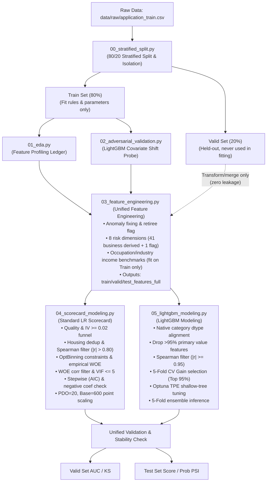

# Retail Credit Default Risk Modeling (Scorecard & LightGBM)

**English** | [简体中文](README_zh.md)

[](https://www.python.org/) [](https://github.com/astral-sh/uv) [](https://lightgbm.readthedocs.io/) [](https://gnpalencia.org/optbinning/) [](#) [](LICENSE)

## 1. Background and core design

This project builds a retail credit default modeling pipeline on the Kaggle [Home Credit Default Risk](https://www.kaggle.com/competitions/home-credit-default-risk) dataset, following standard credit risk modeling and audit practices.

The main application table (`application_train.csv`) has imbalanced classes (roughly 8.07% defaults), high-dimensional sparse columns, and differences across external credit bureaus. The pipeline covers stratified splitting, adversarial validation, feature engineering, a Logistic Regression scorecard, and a LightGBM model.

### Main design choices

1. **Stratified splitting and isolation (zero data leakage)**
   - Before any EDA, outlier handling, binning, or feature selection, the raw training data is split 80/20 by `TARGET`. The 20% validation set (`Valid`, 61,503 rows) stays isolated from all fitting steps.
   - Preprocessing rules, group statistics, binning boundaries, and feature filters are fitted only on `Train`, then applied to `Valid` and `Test` by transform or left join.
2. **Train-vs-test adversarial validation**
   - A shallow, regularized LightGBM classifier (`max_depth=5`, `num_leaves=16`, `min_child_samples=50`) separates `Train` from `Test` with an AUC of 0.89, which shows clear covariate shift between the two datasets.
   - Adversarial feature importances are not used to drop features, since doing so would leak test-set distribution information. Instead, the 0.89 AUC sets a reference point for input drift: even with that shift, the final models built from financial ratios, constrained binning, and regularization reach Test PSI values of 0.00133 (Scorecard) and 0.00141 (LightGBM), well below 0.10.
3. **Feature engineering across 8 dimensions (42 derived features)**
   - Anomaly cleaning and flagging: Resets `DAYS_EMPLOYED == 365243` (~1,000 years, used for retirees or non-salaried applicants) to `NaN` and records it in `FLAG_DAYS_EMPLOYED_ANOMALOUS`; replaces rare `'XNA'` entries in `CODE_GENDER` with `'F'`; and sets extreme social circle outliers (`OBS_* > 30`) along with their paired default counts to `NaN`.
   - Dimension 1, Repayment ability and debt burden (5 features): `CREDIT_TO_INCOME_RATIO`, `ANNUITY_TO_INCOME_RATIO` (single payment divided by annual income), `FREE_INCOME_PROXY` (monthly income minus annuity), `INCOME_PER_PERSON`, and `INCOME_PER_CHILD`. Relative ratios reduce sensitivity to absolute income levels and regional price differences.
   - Dimension 2, Loan terms and collateral coverage (5 features): `ANNUITY_TO_CREDIT_RATIO`, `ESTIMATED_TENURE`, `GOODS_TO_CREDIT_RATIO`, `DOWN_PAYMENT_PROXY` (positive values indicate borrower equity; negative values indicate financed fees or insurance, which carry higher default risk), and `ANNUITY_TO_GOODS_RATIO`.
   - Dimension 3, External credit score interactions (9 features): Mean, min, max, standard deviation, triple product, dynamically normalized IV-weighted score (`EXT_SOURCE_WEIGHTED` with 2:3:5 weights), missing count (`EXT_SOURCE_NAN_CNT`), and cross-ratios with leverage and age across `EXT_SOURCE_1/2/3`.
   - Dimension 4, Temporal stability and lifecycle ratios (8 features): Divides negative day counts by borrower age to remove age-driven correlation, covering `EMPLOYED_TO_BIRTH_RATIO`, `CAR_TO_BIRTH_RATIO`, ID/registration/phone stability ratios, `PHONE_TO_EMPLOYED_RATIO`, `AGE_AT_EMPLOYMENT`, and `REG_TO_ID_RATIO`.
   - Dimension 5, Missingness patterns and asset completeness (3 features): Records structural missingness via `HOUSE_INFO_MISSING_RATE` (over normalized `_AVG` housing fields), `FLAG_OWN_CAR_MISSING`, and `TOTAL_NAN_COUNT` (counted only over raw columns so derived `NaN`s are not double-counted).
   - Dimension 6, Identity verification and social circle risk (4 features): Total submitted documents (`DOCUMENTS_PROVIDED_CNT`), average address mismatch across city and region flags (`ADDRESS_MISMATCH_MEAN`), and 30/60 DPD social circle default rates (`DEF_OBS_RATIO_30`, `DEF_OBS_RATIO_60`).
   - Dimension 7, Credit inquiry trends and short-term surge (3 features): Total bureau inquiries (`BUREAU_REQ_TOTAL` with `min_count=1` to keep all-missing rows as `NaN`), inquiry presence flag (`FLAG_BUREAU_REQ`), and short-to-long inquiry ratio (`BUREAU_REQ_SHORT_TO_LONG`).
   - Dimension 8, Occupation and industry income benchmarks (4 features, fit on `Train` only): Computes group mean income by `OCCUPATION_TYPE` and `ORGANIZATION_TYPE` on `Train`, then maps them to `Valid` and `Test` via left join to form `INCOME_TO_OCCUPATION_TYPE_RATIO` and `INCOME_TO_ORGANIZATION_TYPE_RATIO`.
   - Unified feature table: `03_feature_engineering.py` writes standardized wide tables (`120 raw + 1 anomaly flag + 41 business derived = 162 candidate features`; 164 columns for train and valid with `SK_ID_CURR` and `TARGET`, 163 for test) for both models.
4. **Scorecard (LR) and LightGBM modeling**
   - Standard credit scorecard (Logistic Regression): Loads the unified feature tables, maps education level ordinally, drops features with primary value ratio > 95% or missing rate > 90%, screens with `OptBinning` (`IV >= 0.02`, `max_n_prebins=30`, `min_prebin_size=0.02`, `cat_cutoff=0.01`, `special_codes=['XNA']`), deduplicates housing suffixes and correlated housing size fields, runs greedy Spearman filtering (`|r| > 0.80`), fits constrained fine bins (`min_bin_size >= 5%`, `min_bin_n_event >= 30`, monotonic numeric constraints with U-shape allowed on `AMT_GOODS_PRICE`, `ANNUITY_TO_CREDIT_RATIO`, and `GOODS_TO_CREDIT_RATIO`, plus empirical WOE for special and missing bins), removes WOE-space collinearity (`0.80 <= |r| < 1.0`) and `VIF > 5`, runs bidirectional AIC stepwise selection, drops sign-inverted variables until all coefficients are negative, and scales to integer points (`Base Points = 600`, `PDO = 20`).
   - Gradient boosted trees (LightGBM): Keeps continuous distributions and native missing-value splits, aligns `category` dtypes from `Train`, drops features with primary value ratio > 95% or `|r| >= 0.95`, keeps the 53 features making up the top 95% of 5-fold CV split gain, tunes shallow-tree and L1/L2 regularization parameters across 30 Optuna TPE trials, and averages 5-fold predictions.

## 2. Experimental results and evaluation

Models are evaluated on the isolated `Valid` split and the unlabeled `Test` set.

### 2.1 Model performance comparison

| Model architecture | Split | Samples | ROC-AUC | KS | Population stability (PSI) | Notes |
|:--- |:--- |:---:|:---:|:---:|:---:|:--- |
| **LightGBM (5-Fold CV + Optuna)** | Train (5-Fold OOF) | 246,008 | **0.7676** | **0.3991** | Baseline (0.00000) | 5-fold CV tree ensemble |
| **LightGBM (5-Fold CV + Optuna)** | Valid | 61,503 | **0.7658** | **0.3982** | - | Held-out validation |
| **LightGBM (5-Fold CV + Optuna)** | Test | 48,744 | - | - | **0.00141** | Stable on test set (PSI < 0.10) |
| **Standard Scorecard (OptBinning)** | Train | 246,008 | 0.7510 | 0.3733 | Baseline (0.00000) | Monotonic WOE + VIF + stepwise LR, integer points |
| **Standard Scorecard (OptBinning)** | Valid | 61,503 | 0.7456 | 0.3655 | - | Held-out validation |
| **Standard Scorecard (OptBinning)** | Test | 48,744 | - | - | **0.00133** | Stable on test set (PSI < 0.10) |

> [!NOTE]
> A PSI below `0.10` is standard practice for distribution stability in credit risk monitoring. Even though adversarial validation found substantial feature drift between `Train` and `Test` (`AUC = 0.89`), both the Scorecard total score (`PSI = 0.00133`) and LightGBM predicted probabilities (`PSI = 0.00141`) stay stable on `Test`.

### 2.2 Stratified split audit (`split_audit.csv`)

| Dataset | Samples | Share | Non-Default (0) | Default (1) | Bad Rate |
|:--- |:---:|:---:|:---:|:---:|:---:|
| Raw Train | 307,511 | 100.00% | 282,686 | 24,825 | 8.0729% |
| **Train** | 246,008 | 80.00% | 226,148 | 19,860 | 8.0729% |
| **Valid** | 61,503 | 20.00% | 56,538 | 4,965 | 8.0728% |

## 3. Pipeline architecture

Run the scripts in `baseline/` in numerical order:



<details>
<summary>Expand ASCII architecture diagram</summary>

```text
                    [ Raw Data: data/raw/application_train.csv ]
                                       │
                ┌──────────────────────┴──────────────────────┐
                │ 00_stratified_split.py (80/20 Isolation)    │
                └──────────────────────┬──────────────────────┘
                                       │
            ┌──────────────────────────┴──────────────────────────┐
            ▼                                                     ▼
       [ Train (80%) ]                                      [ Valid (20%) ]
       (Fit rules only)                                     (Held-out eval only)
            │                                                     │
   ┌────────┴────────┐                                            │
   ▼                 ▼                                            │
01_eda.py    02_adversarial_validation.py                         │
(EDA Ledger) (Covariate Shift Probe)                              │
   │                 │                                            │
   └────────┬────────┘                                            │
            ▼                                                     │
03_feature_engineering.py (Unified Feature Engineering) ◄─────────┘
- Anomaly fixing & retiree flag
- 8 risk dimensions (41 business derived + 1 flag)
- Occupation/industry income benchmarks (fit on Train only)
- Outputs: train_features_full, valid_features_full, test_features_full
            │
            ├─────────────────────────────────┐
            ▼                                 ▼
04_scorecard_modeling.py             05_lightgbm_modeling.py
(Standard LR Scorecard)              (LightGBM Modeling)
- Quality & IV >= 0.02 screen        - Native category alignment
- Housing dedup & |r| > 0.80 filter  - Drop >95% primary value features
- OptBinning & empirical WOE         - Spearman filter (|r| >= 0.95)
- WOE corr & VIF <= 5                - 5-Fold CV Gain selection (Top 95%)
- Stepwise (AIC) & coef sign check   - Optuna TPE tuning
- PDO=20, Base=600 scaling           - 5-Fold ensemble inference
            │                                 │
            └────────────────┬────────────────┘
                             ▼
                  [ Unified Evaluation ]
                             │
            ┌────────────────┴────────────────┐
            ▼                                 ▼
     [ Valid AUC / KS ]               [ Test Set PSI ]
```

</details>

## 4. Script breakdown

- **`baseline/00_stratified_split.py`**:
  Splits the 307,511 raw training records 80/20 by `TARGET` (`random_state=123`). Checks primary key uniqueness, zero ID overlap, and bad-rate difference (< 0.01%), then saves `split_audit.csv`.
- **`baseline/01_eda.py`**:
  Profiles all 120 raw business columns on `Train` (missing rates, primary value ratios, quantiles, and optimal-binning IV with `max_n_prebins=30`, `min_prebin_size=0.02`, `cat_cutoff=0.01`, `special_codes=[365243, 'XNA']`), verifies co-missing housing groups and `DAYS_EMPLOYED=365243`, and writes `raw_features_summary.csv`.
- **`baseline/02_adversarial_validation.py`**:
  Trains a 5-fold shallow LightGBM (`max_depth=5`, `num_leaves=16`, `min_child_samples=50`) to predict `is_test`, getting `AUC = 0.89`. The output is used only to measure train/test distribution shift, not to filter features.
- **`baseline/03_feature_engineering.py`**:
  Cleans anomalies (`FLAG_DAYS_EMPLOYED_ANOMALOUS`, `'XNA'` gender, social circle `> 30`), builds 41 domain features across 8 dimensions (42 new columns in total), computes occupation and organization mean incomes on `Train` only before left-joining to `Valid` and `Test`, and saves `data/processed/*_features_full.csv` (162 candidate features) along with `full_features_summary.csv`.
- **`baseline/04_scorecard_modeling.py`**:
  Loads the unified feature tables, maps `NAME_EDUCATION_TYPE` ordinally, filters data quality and `IV >= 0.02`, deduplicates housing features, applies greedy Spearman filtering (`|r| > 0.80`), fits constrained `OptBinning` (`max_n_prebins=30`, `min_prebin_size=0.02`, `min_bin_size=0.05`, `min_bin_n_event=30`, `cat_cutoff=0.01`, `special_codes=['XNA']`, empirical WOE for special and missing bins, monotonic and U-shape constraints), removes WOE-space collinearity (`0.80 <= |r| < 1.0`) and `VIF <= 5.0`, runs bidirectional AIC stepwise selection, drops 5 sign-inverted features to enforce consistent risk direction, and fits an unpenalized LR scorecard (`PDO = 20`, `Base = 600`) with 26 final features, writing `final_scorecard_table.csv` and `scorecard_eval_summary.csv`.
- **`baseline/05_lightgbm_modeling.py`**:
  Loads the unified feature tables, aligns native `category` dtypes, drops features with `primary_value_ratio > 0.95` and `|r| >= 0.95`, keeps the 53 features covering the top 95% of cumulative 5-fold CV split gain, runs 30 Optuna TPE trials for tree depth, leaves, and L1/L2 regularization, and evaluates the 5-fold ensemble (`lgb_eval_summary.csv`, `lgb_feature_importance.csv`).

## 5. Main risk drivers

Across Scorecard IV and LightGBM split gain, the strongest risk predictors fall into four groups:

1. External credit scores: `EXT_SOURCE_MEAN`, `EXT_SOURCE_MIN`, `EXT_SOURCE_3`, and `EXT_SOURCE_2`. Each has univariate IV above 0.32, and together they account for nearly half of the split gain in LightGBM.
2. Leverage and repayment capacity: `GOODS_TO_CREDIT_RATIO` (collateral coverage vs. over-financing), `AMT_ANNUITY`, and `ANNUITY_TO_CREDIT_RATIO` (effective payment rate and inverse tenure).
3. Applicant stability and profile: `DAYS_BIRTH`, `DAYS_EMPLOYED`, `EMPLOYED_TO_BIRTH_RATIO`, and `ORGANIZATION_TYPE` / `OCCUPATION_TYPE`.
4. Behavioral and inquiry signals: `DAYS_LAST_PHONE_CHANGE`, `TOTAL_NAN_COUNT` (application completeness), and `BUREAU_REQ_SHORT_TO_LONG` (short-term borrowing surge).

## 6. Project structure

```
home-credit-default-risk/
├── baseline/                               # Modular modeling pipeline scripts
│   ├── 00_stratified_split.py              # 1. 80/20 stratified split & isolation
│   ├── 01_eda.py                           # 2. EDA & raw feature profiling
│   ├── 02_adversarial_validation.py        # 3. LightGBM adversarial validation
│   ├── 03_feature_engineering.py           # 4. Unified 8-dimension feature engineering
│   ├── 04_scorecard_modeling.py            # 5. Standard scorecard (IV/Binning/VIF/AIC/PDO)
│   └── 05_lightgbm_modeling.py             # 6. LightGBM (Gain selection/Optuna/5-fold CV)
│
├── data/                                   # Data directory (large files gitignored)
│   ├── raw/                                # Raw Kaggle CSVs
│   │   ├── application_train.csv           # Raw train set (307,511 rows)
│   │   ├── application_test.csv            # Test set (48,744 rows)
│   │   └── HomeCredit_columns_description.csv # Column description dictionary
│   ├── interim/                            # Isolated split files
│   │   ├── application_train_split.csv     # Train split (80%, 246,008 rows)
│   │   └── application_valid.csv           # Valid split (20%, 61,503 rows)
│   └── processed/                          # Unified feature engineering tables
│       ├── train_features_full.csv         # Train wide table (164 cols)
│       ├── valid_features_full.csv         # Valid wide table (164 cols)
│       └── test_features_full.csv          # Test wide table (163 cols)
│
├── outputs/                                # Evaluation summaries & audit reports
│   ├── validation/                         # Split audit & adversarial validation
│   │   ├── split_audit.csv                 # Train/Valid stratified split audit
│   │   └── adversarial_validation_feature_importance.csv
│   ├── eda/                                # Feature dictionaries & profiling
│   │   ├── raw_features_summary.csv        # Raw 120-feature IV/missingness report
│   │   └── full_features_summary.csv       # Full 162-feature quality ledger
│   └── models/                             # Model tables & metrics
│       ├── final_scorecard_table.csv       # Detailed scorecard binning & PDO points
│       ├── scorecard_eval_summary.csv      # Scorecard AUC, KS & Test PSI
│       ├── lgb_feature_importance.csv      # LightGBM gain & cumulative importance
│       └── lgb_eval_summary.csv            # LightGBM OOF, Valid & Test PSI summary
│
├── pyproject.toml                          # Project dependencies (uv)
├── uv.lock                                 # Dependency lockfile
├── .python-version                         # Python version (3.12)
├── LICENSE                                 # MIT License
├── .gitignore                              # Git ignore rules
├── README.md                               # Documentation (English)
└── README_zh.md                            # Documentation (Simplified Chinese)
```

## 7. Quick start

### 7.1 Environment setup (`uv`)

This project uses [uv](https://github.com/astral-sh/uv) with Python 3.12. All dependencies are pinned in `pyproject.toml` and `uv.lock`.

#### 1. Install `uv`

- Windows (PowerShell):
  ```powershell
  powershell -ExecutionPolicy ByPass -c "irm https://astral.sh/uv/install.ps1 | iex"
  ```
- macOS / Linux:
  ```bash
  curl -LsSf https://astral.sh/uv/install.sh | sh
  ```
- Via `pip` (alternative):
  ```bash
  pip install uv
  ```

#### 2. Clone and sync environment

```bash
git clone https://github.com/gorgeous211/home-credit-default-risk.git
cd home-credit-default-risk

uv sync
```

> [!TIP]
> 1. Run scripts directly with `uv run python <script.py>` without manually activating `.venv`.
> 2. LightGBM uses multiple CPU threads by default; install a CUDA-enabled LightGBM build if you want GPU acceleration.
> 3. On Windows, scripts prioritize the virtual environment's `Library/bin` path to prevent OpenBLAS/LAPACK DLL conflicts.

### 7.2 Data preparation

1. Download the dataset from Kaggle: [Home Credit Default Risk Data](https://www.kaggle.com/competitions/home-credit-default-risk/data)
2. Extract `application_train.csv`, `application_test.csv`, and `HomeCredit_columns_description.csv` into `data/raw/`.

### 7.3 Run the pipeline

Run the scripts in numerical order:

```bash
# Step 0: Stratified split & physical isolation
uv run python baseline/00_stratified_split.py

# Step 1: Exploratory data analysis & raw feature summary
uv run python baseline/01_eda.py

# Step 2: Adversarial validation (Train vs. Test)
uv run python baseline/02_adversarial_validation.py

# Step 3: Unified feature engineering & wide table generation
uv run python baseline/03_feature_engineering.py

# Step 4: Standard credit scorecard modeling & PDO scaling
uv run python baseline/04_scorecard_modeling.py

# Step 5: LightGBM modeling & Optuna tuning
uv run python baseline/05_lightgbm_modeling.py
```

## 8. Tools and references

- [uv](https://github.com/astral-sh/uv): Environment and dependency management
- [Kaggle - Home Credit Default Risk](https://www.kaggle.com/competitions/home-credit-default-risk): Competition dataset
- [OptBinning](https://github.com/guillermo-navas-palencia/optbinning): Optimal binning and scorecard scaling
- [Toad](https://github.com/amphibian-dev/toad): Stepwise selection and PSI calculation
- [LightGBM](https://github.com/microsoft/LightGBM): Gradient boosting framework
- [Optuna](https://optuna.org/): Hyperparameter optimization
